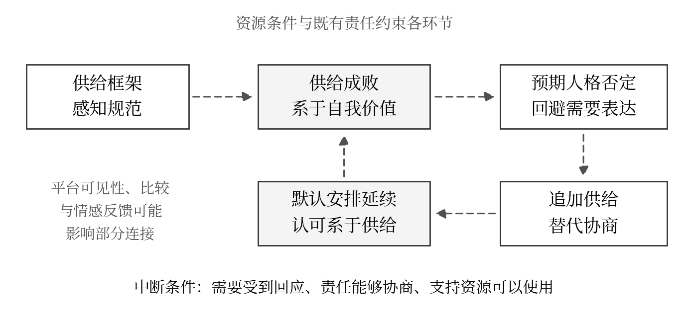

# 后男性主义语境下男性自我工具化的传播机制与主体性重建
以力工思维为分析入口

## 摘要
男性如何摆脱以持续供给证明自身价值的生活逻辑，是性别规范变迁与平台传播交织而成的问题。本文将“后男性主义”视为传统供养规范受到质疑、而责任分配与承认方式仍存在张力的一类问题情境，将网络用语“力工思维”转化为“供给型自我工具化”这一分析概念。通过整合传播学、男性气质研究、条件性自我价值与承认理论，本文提出“供给型承认循环”：供给规范经过框架化和社会比较进入自我评价，个体因预期否定而回避需要表达，以追加投入替代协商；在特定互动条件下，持续供给又可能被自然化，强化人格价值对供给表现的依附。本文进一步区分投入强度、价值条件化与实际协商空间，提出“承认领域错置”及“反力工的绩效回流”两个解释性命题。男性主体性的重建，应体现为基本尊重不以贡献排名为条件、责任能够共同协商、照护与被照护均获承认，并由时间、资源和组织安排支持。本文是一项理论建构，其机制及干预效果仍需经验检验。

关键词：男性气质；自我工具化；框架理论；身份沟通；情感公众；承认；关系性自主

## 一 问题的提出与研究路径
围绕男性付出、婚恋成本与人生选择的讨论，容易落入两种相互替换的解释：一种把持续牺牲视为男性成熟的证明，另一种把减少投入、提高自身“价值”视为摆脱困境的主要路径。本文关心的并非哪种生活方式更划算，而是两种解释是否共享了一个较少被检视的前提：一个男性必须交付某种可被评价的成果，才有资格获得尊重、归属和表达需要的空间。

“力工思维”可以使这种经验获得名称，但它也可能把复杂的处境简化为某些人的认知缺陷。若男性因工作安排、抚养责任或缺少资源而无法减少付出，将其归为“不够清醒”，会把结构性限制重新推回个人。若把所有照护与共同承担视为亏损，又会使反思转化为对责任的回避。因而，研究需要同时回答三个问题：供给如何被转译为人格评价？人为何会用进一步付出替代协商？反对牺牲的话语，何时仍在延续绩效化的自我关系？

传播学能够把这些问题连接起来。它既研究媒介如何选择、突出和组织意义，也研究身份如何在交往中形成，以及哪些人的经验能够进入共同决策。Craig将传播理论视为围绕交往实践展开对话的领域，这为本文跨越媒介、互动与制度层次提供了方法上的启发。不同理论在此承担不同任务，不被视为可以不经转换便拼接成同一因果模型的同质变量。[1]

本文采用问题导向的整合性文献综述与理论建构，检索范围截至2026年10月9日，围绕男性气质、条件性自我价值、身份沟通、框架、情感公众、算法可见性及中国男性网络社群等主题开展中英文关联检索。纳入能够支持概念界定、机制分析或提供反例的学术研究，优先核对期刊与出版社记录、作者公开稿及大学机构库。可得全文用于分析具体论证与方法；仅有摘要或书章介绍的文献只用于其明确支持的主张。本研究不属于穷尽式系统综述，不以所选平台帖子代表男性总体，也不把后文的命题写成已经获得数据验证的结论。

## 二 概念界定与文献基础
### 2.1 后男性主义作为问题情境
“后男性主义”并非一个可以直接套用于当代中国的公认历史分期。Harris在电视研究中使用postmasculinist，考察男性中心叙事对性别秩序变化的复杂回应；这一用法并不意味着父权关系已经终结。本文借用该词指向一类矛盾情境：男性作为供养者、竞争者和问题解决者的规范受到质疑，同时，与之相关的责任分配、评价方式和资源条件未必同步改变。这里的“后”表达的是对既有规范的反思性关系，而非已经完成的社会转型。[2]

男性气质研究也不支持把“男性”视为利益、经历与行为一致的群体。Connell与Messerschmidt强调男性气质的关系性、历史性及其内部等级，支配性的男性气质不等于大多数男性在统计意义上的实际样貌。Bridges与Pascoe对混合男性气质的讨论进一步提示，柔和、平等或反传统的外观，也可能与旧有权力关系并存。[3,4]

中国语境中的职场研究提供了更具体的切口。Li与Chan通过田野观察及对60名男性科技工作者的访谈，讨论职业成功、工作优先、迁移与男性气质的关系。这说明供给压力不能只在亲密关系内部寻找解释，但该研究也不能用于推定全体中国男性的处境。Li等关于中国社会男性气质与父职的理论讨论，则提醒研究者关注代际关系、社会变迁和地方文化，避免直接移植西方个体主义的自主模型。[5,6]

### 2.2 从网络标签到供给型自我工具化
本文不为“力工思维”设定未经核实的网络起源，也不把“力工”当作对体力劳动者的学术分类。体力劳动、节俭、认真履职、长期照护与供给型自我工具化之间，不存在直接等号。本文的工作定义是：个体把自身值得尊重与被接纳的资格，主要系于自己能否持续提供经济资源、劳动、问题解决或情绪支持，并倾向于通过追加投入而非协商来回应关系中的不确定性。

这一界定包含三个不能混同的层面。第一，外部关系可能把人仅视为功能承担者。第二，个体可能内化这种评价，把“没有完成某项贡献”理解为“我这个人没有价值”。第三，个体可能知道自身值得尊重，却仍因现实约束承担过量工作。只有将这三者区分，才不会把被迫劳动、处境不利与认知内化一概称为“思维问题”。

Nussbaum对客体化的分析区分了工具性、否认自主性与忽视主体经验等面向；据此，人与人相互有用本身不足以判定不正当的工具化。问题在于功能评价是否压倒了对人的自主与感受的承认。Crocker与Wolfe的条件性自我价值理论，则帮助解释特定领域中的成败如何进入整体自我评价。Burkley等关于男性气质条件性量表的研究表明，将自我价值系于男性气质的获得或丧失，可以作为专门的心理构念研究；但该量表并非“力工思维量表”，不能直接视为适用于中国情境的现成测量。[7,8,9]

### 2.3 三个维度及其分析位置
本文将“投入强度”“价值条件化”“实际协商空间”作为彼此关联而不可相互替代的维度。投入强度描述行为，应相对于本人的时间、收入、健康与既有承诺理解；价值条件化描述评价机制，是供给型自我工具化的核心；实际协商空间描述关系和制度条件，包括表达能否影响安排、拒绝额外要求的代价，以及可利用的支持资源。

一个为生病家人投入大量时间的人，可能保有稳定的自我价值，并获得其他家庭成员与社会支持。另一个投入很少的人，也可能始终按照外部排名评价自己与他人。因此，低投入不是自主性的充分条件，高投入也不是自我工具化的充分证据。对于暂时无法减少付出的人，主体性还可能体现为准确辨识限制、保留不同的自我叙述，以及在可行范围内逐步争取资源。这三个维度不宜简单相加为“谁更力工”的总分。

## 三 供给型承认循环的传播机制
### 3.1 框架与规范如何规定合格男性
Entman的框架理论关注传播如何通过选择与显著化组织问题定义、原因解释、道德评价和处理建议。将其用于本文，可以识别一种“供给框架”：生活困难被定义为男性能力不足，关系冲突被归因于供给不足，道德评价围绕是否能够承担，处理办法则是进一步努力。供给框架不需要出现在同一条信息中，也可能通过家庭谈话、同伴评价、职业叙事和商业内容相互补充。这里的具体框架是本文的分析性构造，需要通过文本材料检验其分布。[10]

规范性社会行为理论进一步区分“别人普遍怎样做”的描述性规范和“别人赞成我怎样做”的指令性规范，并讨论群体认同与结果预期的作用。看见若干高投入男性，与确信自己必须如此，属于不同判断。一个人可能误把高可见度的生活样本当作普遍事实，再把“似乎多数人如此”转化为“我不这样就不合格”。Rimal与Real的原研究针对饮酒相关意向，本文对男性供给的应用是待检验的理论迁移。[11]

Vandello等提出的“脆弱的男性身份”研究强调，男性身份在特定社会认知中被理解为需要获得并可能丧失的地位。这为解释规范何以具有威胁性提供了线索：拒绝一项额外要求，可能被理解为让“够不够男人”接受重新审查。但并非所有男性、所有社群都采用同一种资格标准；规范的效力取决于评价者的重要性、个体的认同程度以及实际制裁。[12]

### 3.2 身份落差与表达回避
身份沟通理论把身份理解为个人理解、表达实践、关系定位和群体意义相互作用的过程。Jung与Hecht对身份落差及沟通结果的研究，为分析“我需要支持，却持续表现为不需要支持的人”提供了概念。这样的落差未必意味着虚伪，也可能来自谨慎、保护关系或对惩罚的预期。本文关心的是，当这种落差长期不能进入协商，个人经验如何逐渐从共同理解中消失。[13]

Hayes对自我审查的研究表明，表达回避可以采取装作无所谓、表现模糊或转移话题等形式，而不限于完全不发言。这有助于提出一种互动假设：当男性预期需要表达会招致羞辱时，可能用“没事”“我来处理”结束讨论；他人又可能把这种表达理解为安排可继续，由此低估其负担。原研究讨论意见气候，不能据此把亲密关系中的每一次沉默命名为“沉默螺旋”；沉默也可能是自主选择，甚至是降低冲突的策略。[14]

这里存在一个可研究的反馈环节：持续行动代替了对行动条件的说明，未被说出的代价又难以成为重新分配的依据。责任是如何形成的、什么条件下需要调整，逐渐被“他一直如此”遮蔽。这一过程不要求关系中的另一方有意识地谋取利益；家庭成员、同事、朋友与个体本人都可能参与维持默认安排。不过，默认安排也可能因对方主动询问、实际支持或制度调整而中断，不能把互动中的所有结果都解释为循环加强。

### 3.3 平台可见性与被想象的标准
Marwick与boyd关于想象受众及语境坍塌的研究说明，社交媒体可能把原本分属不同交往场景的观众聚到同一表达空间。应用于男性身份，展示疲惫或需求可能同时被亲友、同事和陌生人阅读，表达者因而需要预想不止一种评价。Vogel等关于社交比较与自尊的研究则提供了另一个线索：经过选择的上行比较样本可能影响即时自我评价。但其美国大学生样本与中国男性供给问题之间仍有距离，不能直接推出某类短视频必然降低男性自尊。[15,16]

Bucher的“算法想象”与Cotter的“可见性游戏”提示，人们会根据自己对推荐和流量规则的理解调整表达，算法并非单方面决定一切。由此，本文提出：若供给成就、受伤经历或性别冲突被认为更容易获得互动，内容生产者可能增加这类叙事；普通用户又可能将其高可见度理解为现实中的高普遍性。这里至少需要区分实际排序机制、创作者的规则想象与受众的规范判断，不能仅凭热帖存在就断言平台有意制造某种性别意识。[17,18]

平台研究也应落到具体文化中。吕鹏关于网络主播、江湖表演与男性气质的研究，使我们能够讨论男性形象如何在表演实践及其商业、平台与社会条件中生成，而不把西方平台理论当作充分解释。不同平台、社群和时期可能奖励不同形象，包括可靠供养者、成功竞争者或不受情感牵制者；它们是否共存、相互替代或受到挑战，应由材料回答。[19]

### 3.4 情感公众与受伤经验的组织
Papacharissi的情感公众理论把情感看作组织公众联结与事件意义的力量。对本文而言，它能够解释个人的委屈如何经由叙事、回应与转发形成“我们有相似处境”的共同感，而非简单把情绪视为妨碍理性的噪声。Brady等的研究发现，社会反馈与网络表达规范会影响后续的道德愤怒表达；该证据针对表达行为，不能等同于证明用户内在愤怒必然增长，更不能自动转换为中国性别社群的因果结论。[20,21]

中国相关研究为这种理论迁移提供了有边界的经验参照。Sun与Dai分析81个经过目的性选择的虎扑讨论线程，考察男性气质及性别等级的再生产；Liu与Huang对特定网络禁欲社群的研究，则讨论身体、自律与理想男性身份之间的联结。这些研究说明，男性社群中的“自我改善”可能同时受到规范和同伴评价的组织，但不能代表全部平台用户，更不能证明所有自律行为都具有压迫性。[22,23]

Wu与Zhang已经研究了不稳定处境中男性受害叙事与厌女情感的关联；Huang与Holliday进一步分析反婚话语与经济不安全感、种族化怨恨之间的关系。因此，“经济压力会被转化为性别怨恨”并非本文新发现。本文接续的问题是：即使反对旧有供养义务，个体是否仍把自己和他人置于可比较、可置换的价值等级中？受伤经验可以产生相互支持，也可能被组织为寻找替罪对象的动员；不能依据情感联结本身推定其政治方向。[24,25]

### 3.5 循环的构成与中断条件
综合上述文献，本文提出“供给型承认循环”作为一种可能的动态机制：供给规范获得显著性，个体把供给成败纳入人格评价，因担心否定而回避需要表达，以追加投入维持关系中的可靠形象；若互动只奖励持续供给而不回应其代价，默认安排便可能强化，下一轮供给又成为维持自我价值的办法。图1中的连接均为本文的解释性命题，并非既有研究已经共同证实的完整链条。

循环只在特定条件下成立。短期肯定只有被解释为“因为我继续供给，我才有价值”时，才可能强化价值依附；批评也可能激发拒绝、重新评价或离开，而非一定增加投入。稳定的人格尊重、对实际需求的回应、可使用的支持资源，以及对不合理追加要求的协商，都可能使循环中断。反向路径同样需要检验：具有较高条件性自我价值的人，也可能主动寻找供给叙事，因而不能仅凭接触内容与投入行为相关，就推断媒介造成了这一机制。

图1 供给型承认循环的假设结构

注：作者构建。虚线箭头表示待检验命题；平台作用及资源条件并非已经识别的因果效应。

表1 传播理论的分工及适用边界

| 理论视角 | 本文中的分析任务 | 适用边界 |
| --- | --- | --- |
| 框架与规范 | 解释供给标准如何显著化，并进入合格男性判断 | 区分描述性与指令性规范；内容不等于实际接受 |
| 身份沟通与表达回避 | 分析自我理解、表达实践和关系定位的落差 | 身份落差不等于虚伪；沉默未必源于恐惧 |
| 语境坍塌与社会比较 | 分析多重受众及精选样本带来的评价压力 | 原研究样本不能直接代表中国男性 |
| 算法想象与可见性 | 分析规则理解、表达策略及高可见度的形成 | 区分真实排序、用户想象与感知规范 |
| 情感公众与社会学习 | 解释共同感及表达反馈如何组织网络联结 | 表达不等于内在情绪；联结不保证行动成效 |
| 关系辩证与隐私管理 | 检视不同需要的表达位置及信息披露规则 | 不存在固定最佳平衡；隐私边界不是一切边界 |
| 发声与承认 | 区分叙述机会、理由受到重视及参与资格 | 基本尊重不保证特定对象的爱情或关系持续 |

注：作者依据正文所引文献整理。各视角承担不同解释任务，不构成已经验证的统一因果模型。

## 四 理论推进与原创性边界
### 4.1 承认领域错置
本文提出的第一个理论命题是“承认领域错置”：对某项贡献是否充分的评价，被扩张为对一个人免受羞辱、表达需要及参与相关事务协商之资格的否定。Honneth对关爱、权利和社会尊重的区分，为辨识这种扩张提供了基础；Fraser则提醒我们，把承认局限为个体获得积极评价，可能遮蔽分配问题及制度化的地位不平等。[26,27]

例如，“这个月没有履行已同意的经济责任”可以构成具体的履责批评；“因为你收入低，所以你没有资格疲惫或讨论分工”则把贡献判断升级为资格剥夺。本文不主张所有关系都应无条件持续，也不认为批评某项行为等于否定人格。需要区分基本尊重、履责评价和亲密意愿：贡献可以参与公平分工与信任形成，却不能兑换他人的爱情、性同意或关系持续。关系结束同样不能证明一方失去了作为人的价值。

这一命题的传播学意义，在于研究评价如何通过语言发生跨领域迁移。“我不同意这项安排”何时被重述为“你不配承担这个身份”？“我需要休息”何时被改写为“你不够负责”？这些转换是可以在交往材料中定位的。相应地，主体性不宜仅用自我感觉良好衡量，还应观察个体的解释是否被当作值得回应的理由。Couldry对voice作为叙述自身生活的过程、以及让这种叙述真正受到重视的价值条件之区分，使“发声”与“说了以后有作用”之间的差异成为理论问题。[28]

### 4.2 反力工的绩效回流
第二个命题是“反力工的绩效回流”：个体放弃原有的供养指标，却继续按照竞争排名与外部认证决定自身价值，把经济牺牲转化为吸引力、情绪控制或人生成功的持续考核。这里的回流指条件性人格评价的延续，并不意味着供给对象、行为形式与原有机制全部保持不变。Illouz对情感资本主义的分析，为审视经济评价与亲密关系如何交织提供了参照；混合男性气质及中国男性网络社群研究则提醒我们，反传统表达未必改变了性别等级。[29,4,22]

本文并不把赚钱、健身、学习或提高表达能力本身视为问题。绩效回流成立，需要两个条件同时出现：评价指标发生替换，而供给或排名失败仍被解释为整体人格贬值。相反，一个人可以努力提升能力，同时接受失败、保有多种价值来源，并承认他人的平等协商资格；这构成该命题的反例。理论的辨别对象是评价结构，不是某项个人成长行为。

由此还可以提出“二次贬损”的研究问题：一个人是否先因供养不足被指为不合格，又因长期承担责任被反供养话语讥讽为愚笨？后一种评价虽然更换了立场，却可能继续要求困境中的人证明自己足够聪明、成功，才值得受到尊重。这是本文待检验的命题，不是对所有“反力工”表达的事实判决。它要求研究者反思自身使用的网络标签，避免在批判工具化时再给劳动者建立一套优劣排名。

### 4.3 机制具有跨性别可能性但不抹除差异
价值被系于外部绩效并非男性独有。Duffy与Hund对女性时尚博主及自我品牌化的研究，展示了另一种把个人生活组织成可展示成就的逻辑。本文认为，男性问题的特殊性不在于男性具有一种独占的心理缺陷，而在于供养规范、男性资格审查与具体资源关系的组合。由此，男性可能在某些性别安排中拥有优势，同时在其他制度与互动场景中遭受损耗，两者需要分别说明。[30,3]

本文的原创性因此受到明确限定：条件性自我价值、男性气质危机、承认与平台情感化均已有丰富研究；本文新增的是把“贡献评价如何侵入协商资格”作为中介问题，并以三维区分辨识传统供养与反供养话语可能共享的评价结构。这是一种综合解释及可检验的理论推进，不能据此宣称首次发现男性自我工具化。

## 五 男性主体性的重建路径
### 5.1 从供给资格转向关系性自主
避免供给型自我工具化，首先需要承认关系中的自主性：一个人可以作出承诺、依赖他人并承担长期照护，同时保有表达需要和参与调整的资格。Elliott等对男性自主性与关系性的研究，以及Elliott对关怀男性气质的论述，为理解这种并存提供了依据。关怀男性气质强调拒绝支配、重视积极情感、相互依赖与关系性，不能被缩减为要求男性承担更多无上限的照料。[31,32]

实践上的关键，是把“我愿意承担什么”“当前任务确实需要什么”“我已经承诺什么”“还有谁能够提供支持”区分开来。基本尊重不应等待绩效达标，既有责任也不能因为自我反思而自行消失。拒绝不合理的追加要求、讨论能力边界与拒绝作出新的承诺，属于不同于任意抛弃责任的行动。平等同样要求男性承认伴侣、家人和同事的自主性，以及自己可能享有而此前忽视的照护与劳动。

互惠在这里意味着负担与权利受到共同关切，不要求每一笔付出立即换回等量利益。Clark与Mills区分交换关系与共同体关系，后者重视对需要的回应，有助于说明疾病、育儿及长期照护中的不对称何以仍有伦理意义。儿童和失能者不能提供对等回报，并不取消照护的价值；真正需要讨论的是社会与其他有能力者如何支持照护者。Elliott与Roberts通过英国蓝领男性的两则生命史分析照护经验，也提醒我们，关怀与反思不专属于某种教育或职业阶层。[33,34]

### 5.2 使需要能够表达也能够改变安排
Baxter的关系辩证理论把亲密关系理解为多种话语持续竞争和生成意义的过程。由此，问题不只是为“独立”与“亲密”寻找固定比例，而是“责任”话语是否垄断了正当性，使“疲惫”“不同意”“我也需要支持”等声音无法获得位置。有效的协商应让不同需要进入讨论，并将任务、期限、资源和调整条件具体化。[35]

以共同支出为例，本文建议讨论总额、各方能力、已有承诺和变化后的复议条件；以照护为例，则应讨论任务分配、休息、替代安排及支持来源。它们是从理论推出的实践建议，尚不构成经过验证的干预方案。评价协商效果，也不应只看当事人是否更敢说话，还要看理由是否受到认真回应、能否参与决定，以及拒绝额外要求是否引发人格羞辱或不相称的惩罚。参与程序的平等性与安排改变的程度需要分别考察；经过充分协商而暂时维持原分工，也可能体现自主选择。

表达也需要隐私边界。Petronio的传播隐私管理理论讨论私人信息的披露、共同持有和规则协调，能够提醒我们：一个人可以选择向谁、在何时、以什么程度表达脆弱。它不是涵盖所有经济与责任边界的通用理论。强迫男性向任何人公开全部情绪，同样可能把“善于表达”变成新的表演任务。[36]

Hochschild的情绪工作与情感规则研究，则使我们看见对感受本身的要求；其The Managed Heart中的情绪劳动概念尤其关注情绪管理进入有报酬的职业与组织要求。本文据此把私人关系中压抑委屈、调节自身感受首先称为“情绪工作”，避免把金钱供给、家务、照护和一切疲惫都泛化为同一概念。吕鹏关于线上情感劳动与情动劳动的研究进一步表明，平台化的情感实践需要结合具体生产关系与互动情境分析。[37,38,39]

### 5.3 改善传播环境与支持关系
从传播层面看，扩大自主空间需要改变比较对象、解释资源及回应方式。Hall的编码与解码讨论为受众的协商性理解保留了位置：接触到某种成功男性叙事，不等于必须接受其中的评价标准。媒介素养的重点可以转向检查叙事的样本选择、被省略的支持条件及其商业利益，辨认“很多人正在展示”与“所有人都应如此”之间的跳跃。[40]

支持性社群的价值，不在于证明男性比其他人更受伤，而在于允许成员讲述具体处境、相互提供资源，并把责任归因落实到行为与安排。Addis与Mahalik关于男性求助的情境性讨论表明，求助不能简单解释为个人勇气不足，还需要考察男性气质规范与具体社会情境。由此，减少嘲讽、允许不确定、提供可信赖的支持入口，是比强制积极或鼓励对立更值得检验的传播方向。[41]

对广告与公共传播而言，可以把男性呈现为有能力也有需要、能够照护也接受照护的人，展示协商、合作与资源支持的具体过程。同时应避免把“会照护、会表达、永远稳定”再次包装成必须全部达标的新男性标准。传播效果的评价也应包含受众如何理解责任与尊重，而不能只用互动量证明观念发生了改善。

### 5.4 将时间与资源条件纳入改变
只要求个人调整观念，无法解释那些已经认识到不合理安排却没有行动余地的处境。Sun对中国外卖平台劳动的研究揭示了算法管理与劳动实践之间的具体关系；Li与Chan的科技职场研究也把男性气质放在工作组织与迁移条件中讨论。它们共同提示本文：主体性需要可利用的时间和资源，不能仅通过正确话术获得。[42,5]

因此，本文提出的制度方向包括：使工作评价减少对无边界可用性的依赖，为照护安排保留可实际使用的时间，建立可获得的支持服务，并使家庭与组织中的分工具备复议渠道。这些是规范性建议，其具体制度形式及效果需要另行研究。尤其应避免把男性减少工作或情绪负担的代价无声转移给女性、低收入劳动者或其他家庭成员；减少自我工具化，应伴随更公平的共同承担。

## 六 可检验命题与研究限制
### 6.1 从综合框架到竞争性检验
命题一：在任务需要、资源条件与既有承诺相近时，以男性资格评价供给表现的信息，比仅讨论任务分工的信息更可能强化供给条件性自我价值；这一关系受到群体认同与评价者重要性的影响。检验需要把实际规范、感知规范及媒介接触分别测量，并处理个体主动选择内容的可能性。

命题二：在其他条件相近时，将拒绝额外供给回应为人格羞辱，比将其回应为可讨论的分歧，更可能增加额外投入；这一效应在供给条件性自我价值较高者中更强。研究应同时测量一般冲突回避、关系依赖与任务紧迫性。若投入主要随实际需要变化，或上述交互作用完全被一般冲突回避解释，就应削弱供给型承认作为独立机制的主张。

命题三：强调竞争排名、吸引力认证和对他人控制的反供养信息，可能降低对他人的支出意愿，却未必降低人格价值对外部表现的依赖。与允许失败、承认相互需要的叙事比较，研究应分别观察行为变化与价值条件化。如果前一类信息同时带来稳定的自我价值和更平等的协商，则不能将其判定为绩效回流。

命题四：需要表达能否转化为分工变化，受到实际协商空间的调节。应通过纵向访谈、互动记录和在知情同意下取得的关系双方资料，区分开口表达、对方回应与安排变化。只有观察到时间上的再投入及相应评价，才有理由支持反馈循环；横截面相关或单方回忆不能独立证明循环成立。

### 6.2 测量与外推边界
后续研究应先通过访谈与认知测试检验“供给”在不同群体中的含义，再开发并验证测量。可分别考察相对投入、供给失败后的整体自我贬值、参与决定的实际程度、拒绝额外要求的代价，以及照护与支持的可获得性。既有男性气质条件性量表可提供参照，但不能省略本土化、区分效度与群体差异检验。本文不提供具有诊断效力的自测分数。

本文的主要限制有三项：其一，文献选择服务于机制建构，未形成穷尽检索和效应量综合；其二，部分研究来自西方平台或特定职业、社群，迁移到中国男性生活需要补充材料；其三，本文较多围绕异性恋婚恋、家庭与职场供给规范展开，不能代表所有性取向、年龄、阶层与家庭形式。还应直接纳入女性及其他关系参与者的经验，检验男性自述中的负担、获益与沉默是否被准确理解。

## 七 结论
男性避免“力工思维”的关键，在于改变贡献与人格价值之间的连接方式。本文以供给型自我工具化界定问题，将投入强度、价值条件化与实际协商空间区分开来，提出框架、规范、身份沟通和平台反馈可能共同构成的供给型承认循环，并以承认领域错置和绩效回流识别其持续条件。

这一框架使高投入的自主照护、受资源限制的被迫承担，以及以供给证明人格资格的自我关系，成为可以分别研究的对象。它也要求反思某些反牺牲叙事是否只是更换了竞争指标。主体性的重建，应表现为个体不必以持续证明有用来换取基本尊重，能够在承认他人自主性的前提下表达需要、协商责任、照护与被照护。这样的改变需要新的叙事，也需要使叙事能够影响生活安排的实际条件。
## 参考文献

[1] Craig, R. T. (1999). Communication theory as a field. Communication Theory, 9(2), 119–161.

[DOI: 10.1111/j.1468-2885.1999.tb00355.x](https://doi.org/10.1111/j.1468-2885.1999.tb00355.x)

[2] Harris, G. (2012). A return to form? Postmasculinist television drama and tragic heroes in the wake of The Sopranos. New Review of Film and Television Studies, 10(4), 443–463.

[DOI: 10.1080/17400309.2012.708272](https://doi.org/10.1080/17400309.2012.708272)

[3] Connell, R. W., & Messerschmidt, J. W. (2005). Hegemonic masculinity: Rethinking the concept. Gender & Society, 19(6), 829–859.

[DOI: 10.1177/0891243205278639](https://doi.org/10.1177/0891243205278639)

[4] Bridges, T., & Pascoe, C. J. (2014). Hybrid masculinities: New directions in the sociology of men and masculinities. Sociology Compass, 8(3), 246–258.

[DOI: 10.1111/soc4.12134](https://doi.org/10.1111/soc4.12134)

[5] Li, X., & Chan, J. (2024). Migrate to (not) be “gurus”: Unpacking workplace masculinity in China’s tech sector. Gender, Work & Organization, 31(6), 2618–2633.

[DOI: 10.1111/gwao.13112](https://doi.org/10.1111/gwao.13112)

[6] Li, X., Hu, Y., Huang, C.-Y. S., & Chuang, S. S. (2021). Beyond W.E.I.R.D. (Western, educated, industrial, rich, democratic)-centric theories and perspectives: Masculinity and fathering in Chinese societies. Journal of Family Theory & Review, 13(3), 317–333.

[DOI: 10.1111/jftr.12403](https://doi.org/10.1111/jftr.12403)

[7] Nussbaum, M. C. (1995). Objectification. Philosophy & Public Affairs, 24(4), 249–291.

[DOI: 10.1111/j.1088-4963.1995.tb00032.x](https://doi.org/10.1111/j.1088-4963.1995.tb00032.x)

[8] Crocker, J., & Wolfe, C. T. (2001). Contingencies of self-worth. Psychological Review, 108(3), 593–623.

[DOI: 10.1037/0033-295X.108.3.593](https://doi.org/10.1037/0033-295X.108.3.593)

[9] Burkley, M., Wong, Y. J., & Bell, A. C. (2016). The Masculinity Contingency Scale (MCS): Scale development and psychometric properties. Psychology of Men & Masculinity, 17(2), 113–125.

[DOI: 10.1037/a0039211](https://doi.org/10.1037/a0039211)

[10] Entman, R. M. (1993). Framing: Toward clarification of a fractured paradigm. Journal of Communication, 43(4), 51–58.

[DOI: 10.1111/j.1460-2466.1993.tb01304.x](https://doi.org/10.1111/j.1460-2466.1993.tb01304.x)

[11] Rimal, R. N., & Real, K. (2005). How behaviors are influenced by perceived norms: A test of the theory of normative social behavior. Communication Research, 32(3), 389–414.

[DOI: 10.1177/0093650205275385](https://doi.org/10.1177/0093650205275385)

[12] Vandello, J. A., Bosson, J. K., Cohen, D., Burnaford, R. M., & Weaver, J. R. (2008). Precarious manhood. Journal of Personality and Social Psychology, 95(6), 1325–1339.

[DOI: 10.1037/a0012453](https://doi.org/10.1037/a0012453)

[13] Jung, E., & Hecht, M. L. (2004). Elaborating the communication theory of identity: Identity gaps and communication outcomes. Communication Quarterly, 52(3), 265–283.

[DOI: 10.1080/01463370409370197](https://doi.org/10.1080/01463370409370197)

[14] Hayes, A. F. (2007). Exploring the forms of self-censorship: On the spiral of silence and the use of opinion expression avoidance strategies. Journal of Communication, 57(4), 785–802.

[DOI: 10.1111/j.1460-2466.2007.00368.x](https://doi.org/10.1111/j.1460-2466.2007.00368.x)

[15] Marwick, A. E., & boyd, d. (2011). I tweet honestly, I tweet passionately: Twitter users, context collapse, and the imagined audience. New Media & Society, 13(1), 114–133.

[DOI: 10.1177/1461444810365313](https://doi.org/10.1177/1461444810365313)

[16] Vogel, E. A., Rose, J. P., Roberts, L. R., & Eckles, K. (2014). Social comparison, social media, and self-esteem. Psychology of Popular Media Culture, 3(4), 206–222.

[DOI: 10.1037/ppm0000047](https://doi.org/10.1037/ppm0000047)

[17] Bucher, T. (2017). The algorithmic imaginary: Exploring the ordinary affects of Facebook algorithms. Information, Communication & Society, 20(1), 30–44.

[DOI: 10.1080/1369118X.2016.1154086](https://doi.org/10.1080/1369118X.2016.1154086)

[18] Cotter, K. (2019). Playing the visibility game: How digital influencers and algorithms negotiate influence on Instagram. New Media & Society, 21(4), 895–913.

[DOI: 10.1177/1461444818815684](https://doi.org/10.1177/1461444818815684)

[19] 吕鹏. (2024). 从“社会人儿”到“精神小伙”：网络主播、江湖表演与男性气质. 国际新闻界, 46(6), 133–153.

[原文与书目信息](https://cjjc.ruc.edu.cn/CN/Y2024/V46/I6/133)

[20] Papacharissi, Z. (2015). Affective publics: Sentiment, technology, and politics. Oxford University Press.

[DOI: 10.1093/acprof:oso/9780199999736.001.0001](https://doi.org/10.1093/acprof:oso/9780199999736.001.0001)

[21] Brady, W. J., McLoughlin, K., Doan, T. N., & Crockett, M. J. (2021). How social learning amplifies moral outrage expression in online social networks. Science Advances, 7(33), eabe5641.

[DOI: 10.1126/sciadv.abe5641](https://doi.org/10.1126/sciadv.abe5641)

[22] Sun, L., & Dai, L. (2026). Welcome to this Brave Bro’s World: The (re)production of hegemonic masculinity in a Chinese manosphere. Feminist Media Studies, 26(1), 315–330.

[DOI: 10.1080/14680777.2024.2400488](https://doi.org/10.1080/14680777.2024.2400488)

[23] Liu, C., & Huang, Q. (2025). ‘Abstinence is panacea’: Reconstructing the ideal of Chinese masculinity through online community. Sexualities, 28(3), 1028–1047.

[DOI: 10.1177/13634607241228114](https://doi.org/10.1177/13634607241228114)

[24] Wu, H., & Zhang, Y. (2025). Wounded hearts: The affective making of misogynistic male victimhood under the familial sexual contract in precarious China. International Journal of Cultural Studies, 28(4), 814–830.

[DOI: 10.1177/13678779251323923](https://doi.org/10.1177/13678779251323923)

[25] Huang, Q., & Holliday, R. (2026). The anti-marriage turn: Economic precarity and racialized grievance in the Chinese manosphere. Journal of Gender Studies. Advance online publication.

[DOI: 10.1080/09589236.2026.2693073](https://doi.org/10.1080/09589236.2026.2693073)

[26] Honneth, A. (1995). The struggle for recognition: The moral grammar of social conflicts (J. Anderson, Trans.). Polity Press.

[原文与书目信息](https://www.wiley-vch.de/en/areas-interest/humanities-social-sciences/the-struggle-for-recognition-978-0-7456-1160-0)

[27] Fraser, N. (2000). Rethinking recognition. New Left Review, 3, 107–120.

[原文与书目信息](https://newleftreview.org/issues/ii3/articles/nancy-fraser-rethinking-recognition)

[28] Couldry, N. (2010). Why voice matters: Culture and politics after neoliberalism. SAGE.

[原文与书目信息](https://www.sagepub.com/shop/buy-a-book/why-voice-matters-1-233759)

[29] Illouz, E. (2007). Cold intimacies: The making of emotional capitalism. Polity Press.

[原文与书目信息](https://www.politybooks.com/bookdetail?book_slug=cold-intimacies-the-making-of-emotional-capitalism--9780745639048)

[30] Duffy, B. E., & Hund, E. (2015). “Having it all” on social media: Entrepreneurial femininity and self-branding among fashion bloggers. Social Media + Society, 1(2), 1–11.

[DOI: 10.1177/2056305115604337](https://doi.org/10.1177/2056305115604337)

[31] Elliott, K., Roberts, S., Ralph, B., Robards, B., & Savic, M. (2022). Understanding autonomy and relationality in men’s lives. The British Journal of Sociology, 73(3), 571–586.

[DOI: 10.1111/1468-4446.12947](https://doi.org/10.1111/1468-4446.12947)

[32] Elliott, K. (2016). Caring masculinities: Theorizing an emerging concept. Men and Masculinities, 19(3), 240–259.

[DOI: 10.1177/1097184X15576203](https://doi.org/10.1177/1097184X15576203)

[33] Clark, M. S., & Mills, J. (1979). Interpersonal attraction in exchange and communal relationships. Journal of Personality and Social Psychology, 37(1), 12–24.

[DOI: 10.1037/0022-3514.37.1.12](https://doi.org/10.1037/0022-3514.37.1.12)

[34] Elliott, K., & Roberts, S. (2024). Caring masculinities among working-class men in blue-collar occupations in the UK: Understanding biographies of care. Gender, Work & Organization, 31(5), 1690–1706.

[DOI: 10.1111/gwao.12936](https://doi.org/10.1111/gwao.12936)

[35] Baxter, L. A. (2004). A tale of two voices: Relational dialectics theory. Journal of Family Communication, 4(3–4), 181–192.

[DOI: 10.1080/15267431.2004.9670130](https://doi.org/10.1080/15267431.2004.9670130)

[36] Petronio, S. (2010). Communication privacy management theory: What do we know about family privacy regulation? Journal of Family Theory & Review, 2(3), 175–196.

[DOI: 10.1111/j.1756-2589.2010.00052.x](https://doi.org/10.1111/j.1756-2589.2010.00052.x)

[37] Hochschild, A. R. (1979). Emotion work, feeling rules, and social structure. American Journal of Sociology, 85(3), 551–575.

[DOI: 10.1086/227049](https://doi.org/10.1086/227049)

[38] Hochschild, A. R. (1983). The managed heart: Commercialization of human feeling. University of California Press.

[原文与书目信息](https://books.google.com/books/about/The_Managed_Heart.html?id=KBMU952UzcgC)

[39] 吕鹏. (2021). 线上情感劳动与情动劳动的相遇：短视频/直播、网络主播与数字劳动. 国际新闻界, 43(12), 53–76.

[原文与书目信息](https://cjjc.ruc.edu.cn/CN/Y2021/V43/I12/53)

[40] Hall, S. (1973). Encoding and decoding in the television discourse. Stencilled Occasional Papers, No. 7. Centre for Contemporary Cultural Studies, University of Birmingham.

[原文与书目信息](https://epapers.bham.ac.uk/id/eprint/2962/)

[41] Addis, M. E., & Mahalik, J. R. (2003). Men, masculinity, and the contexts of help seeking. American Psychologist, 58(1), 5–14.

[DOI: 10.1037/0003-066X.58.1.5](https://doi.org/10.1037/0003-066X.58.1.5)

[42] Sun, P. (2019). Your order, their labor: An exploration of algorithms and laboring on food delivery platforms in China. Chinese Journal of Communication, 12(3), 308–323.

[DOI: 10.1080/17544750.2019.1583676](https://doi.org/10.1080/17544750.2019.1583676)
